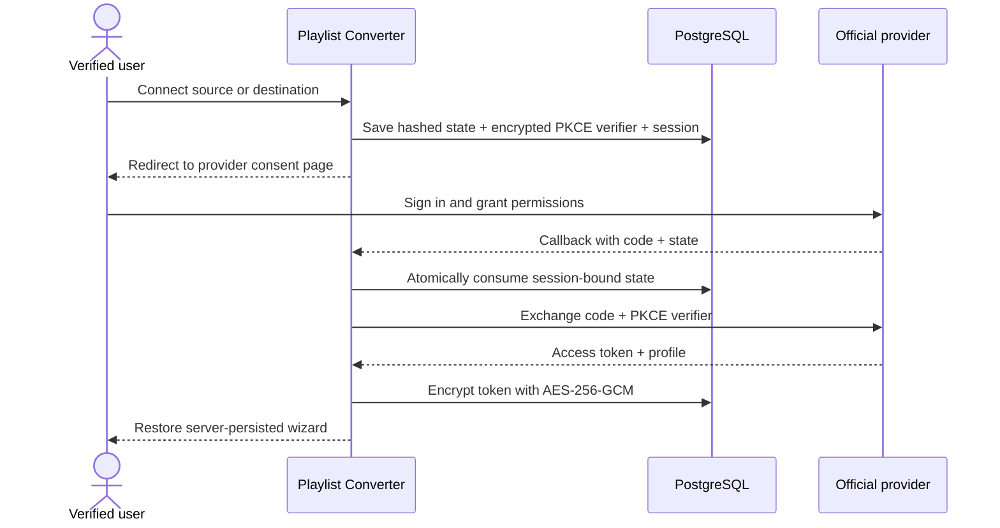
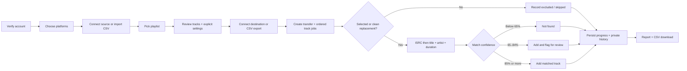

<p align="center"><strong>New platform. Same soundtrack.</strong><br/>Secure playlist transfers, thoughtful track controls, and a home for every playlist.</p>

<p align="center">
<a href="LICENSE"></a>


</p>

**Live app:** [Playlist Converter](https://playlist-converter-alpha.vercel.app)

The current deployment enables YouTube OAuth and CSV import/export for every platform. Other direct adapters remain available in source but need approved provider credentials; the UI shows CSV when an integration is not configured. Google publishing/verification restrictions are shown in the wizard. Temporary Gmail sender setup and later domain migration are documented in [the email guide](docs/TEMPORARY-EMAIL.md).

> **Implementation status:** Local Next.js app with complete account flows, PostgreSQL persistence, six direct adapter implementations (Spotify, Apple Music, YouTube, Deezer, TIDAL, SoundCloud), CSV transport for every platform pair, resumable transfer jobs, and private history. A live CSV → YouTube Music transfer has been tested with an authorized account: private playlist creation, two matched tracks, CSV reporting, and visibility in YouTube Music were verified. Other direct providers still need live testing with approved credentials. Amazon Music and Pandora use **CSV**, not direct APIs. Provider scope and endpoint availability can vary by approval tier.
>
> Registration is free and open without a whitelist. Provider restrictions still apply: Spotify development apps currently have a five-user authorization cap and a Premium requirement. Public Spotify support needs provider approval. See [Spotify’s announcement](https://developer.spotify.com/blog/2026-02-06-update-on-developer-access-and-platform-security).

[](https://github.com/muffin4lol/playlist-converter/actions/workflows/ci.yml)


## See it in action

| Screen                   | Preview                                            |
| ------------------------ | -------------------------------------------------- |
| Landing page             | [Screenshot](docs/screenshots/landing.jpg)         |
| Login                    | [Screenshot](docs/screenshots/login.jpg)           |
| Conversion wizard        | [Screenshot](docs/screenshots/wizard.jpg)          |
| Explicit-track controls  | [Screenshot](docs/screenshots/explicit-filter.jpg) |
| Private transfer history | [Screenshot](docs/screenshots/history.jpg)         |
| Demo GIF                 | Placeholder: `docs/screenshots/demo.gif`           |

## Features

- 🔐 Open registration with required first name, last name, email, and confirmed password; verification required before conversions.
- ✉️ Single-use email verification and password reset links, generic recovery responses, and session invalidation after reset.
- 🛡️ bcrypt password hashes, opaque hashed sessions, httpOnly cookies, Origin-based CSRF rejection, persistent rate limits, and login backoff.
- 🔗 Official provider authorization redirects (PKCE where supported), MusicKit consent for Apple Music, user/session-bound single-use OAuth state, and role-specific scopes where offered.
- 🎵 Playlist library selection, validated public links for direct adapters, and CSV imports for every platform.
- 🎚️ Explicit content on by default; bulk exclusion, clean replacement searches, manual per-track overrides, and live selection counts.
- 🔎 ISRC-first matching, title/artist/duration fallback, confidence scores, and low-confidence review flags and a pre-transfer match preview after destination connection.
- ⏳ Server-persisted wizard and track-by-track jobs; bounded retry/backoff for rate limits and safe stop on ambiguous writes.
- 🗂️ Private history with search, platform/status filters, date sorting, pagination, CSV reports, re-run, and deletion.
- 👤 Name editing, password changes, full JSON data export, history deletion, and cascading account deletion.
- 🌗 Responsive dark-first interface, light theme, keyboard controls, ARIA switches, and reduced-motion support.

## Supported platforms

| Platform                | Connection                               | Read playlists                 | Write playlist              | Explicit metadata                                               |
| ----------------------- | ---------------------------------------- | ------------------------------ | --------------------------- | --------------------------------------------------------------- |
| Spotify                 | Authorization Code + PKCE                | Implemented; approval required | Implemented; private        | `explicit`                                                      |
| Apple Music             | MusicKit JS + developer token            | Library and catalog playlists  | Library playlist            | `contentRating`                                                 |
| YouTube / YouTube Music | Google OAuth + PKCE                      | YouTube Data API               | Private YouTube playlists   | Unknown unless age restricted; **not a reliable explicit flag** |
| Deezer                  | Approved legacy OAuth app (no PKCE)      | Own and public playlists       | Provider-default visibility | `explicit_lyrics`                                               |
| TIDAL                   | Authorization Code + PKCE                | Own and public playlists       | Unlisted playlist           | `explicit`                                                      |
| SoundCloud              | OAuth 2.1 + PKCE                         | Own and public playlists       | Private playlist            | Publisher explicit metadata when available; otherwise unknown   |
| Amazon Music            | CSV fallback; no public integration here | CSV import                     | CSV export                  | CSV `explicit`                                                  |
| Pandora                 | CSV fallback; no public integration here | CSV import                     | CSV export                  | CSV `explicit`                                                  |

Every platform pair has a metadata import/export path. Check **Import source from CSV** or **Export destination as CSV** in step 1 to use CSV even for a directly supported provider. A CSV destination **exports metadata and does not create a remote playlist**. A CSV source can target a connected direct adapter. The playlist CSV excludes skipped tracks; the history CSV contains the full results report.

Apple Music uses MusicKit JS rather than a generic OAuth redirect, and requires an active subscriber, developer token, and compatible storefront. SoundCloud and MusicKit do not offer separate read-only consent; their broader permissions are disclosed before connection. TIDAL’s public schema allows unlisted/public creation rather than private creation. Deezer uses the provider’s default playlist visibility. Do not assume every destination is private. No scraping, platform passwords, browser-cookie extraction, or unofficial `ytmusicapi` fallback is implemented. YouTube Music catalog availability can differ from YouTube playlists.

## Quick start

Requires Node.js 22+ and Docker (or your own PostgreSQL 16+ and SMTP server).

```sh
git clone https://github.com/muffin4lol/playlist-converter.git
cd playlist-converter
cp .env.example .env
npm ci
docker compose up -d
# Generate a 32-byte encryption key; paste the result into TOKEN_ENCRYPTION_KEY in .env.
openssl rand -hex 32
npm run db:deploy
npm run dev
```

Open [localhost:3000](http://localhost:3000). Register, then open [Mailpit](http://localhost:8025) and follow the verification link. If you use `127.0.0.1` instead of `localhost`, set `APP_URL` to that exact origin. You can test CSV → CSV without provider keys (enable both CSV transport checkboxes) using [the sample playlist](public/demo-playlist.csv). No seeded public accounts or auth bypasses exist. Local smoke tests create synthetic accounts only in your disposable database.

If PostgreSQL is already available and Docker is not running, you can use the bundled development-only email inbox: run `npm run dev:mail` in a second terminal and set `SMTP_URL="smtp://127.0.0.1:1025"`. Open [the local inbox](http://127.0.0.1:8025) to follow verification/reset links. It holds messages in memory and binds only to your computer; never expose it publicly.

For schema changes use `npm run db:migrate -- --name describe_change`; committed migrations are applied with `npm run db:deploy`.

## Environment

All runtime keys are documented in [.env.example](.env.example). The app uses custom authentication, so no Auth.js secret is needed. Additional provider keys are optional unless that provider is used directly. `TOKEN_ENCRYPTION_KEY` must be exactly 64 hex characters and kept stable. Rotate it only with a plan to discard existing encrypted connections. Never expose it with a `NEXT_PUBLIC_` prefix.

- `DATABASE_URL`: PostgreSQL connection, pooled for production.
- `APP_URL`: exact browser-facing origin; HTTPS in production.
- `SMTP_URL`, `EMAIL_FROM`: Nodemailer SMTP settings, compatible with Resend SMTP. Use a verified sending domain in production.
- `SPOTIFY_CLIENT_ID`: Spotify app identifier, PKCE flow.
- `GOOGLE_CLIENT_ID`, `GOOGLE_CLIENT_SECRET`: Google OAuth web app credentials.
- `APPLE_MUSIC_DEVELOPER_TOKEN`, `APPLE_MUSIC_STOREFRONT`: signed MusicKit developer JWT and catalog storefront.
- `DEEZER_APP_ID`, `DEEZER_APP_SECRET`: approved Deezer application credentials.
- `TIDAL_CLIENT_ID`, optional `TIDAL_CLIENT_SECRET`, `TIDAL_COUNTRY_CODE`: TIDAL app and catalog market.
- `SOUNDCLOUD_CLIENT_ID`, `SOUNDCLOUD_CLIENT_SECRET`: SoundCloud confidential OAuth client.
- `TEST_DATABASE_URL`: reserved for isolated integration environments.

## API keys and redirect URIs

### Spotify

1. Create an app in the [Spotify Developer Dashboard](https://developer.spotify.com/dashboard).
2. Set `SPOTIFY_CLIENT_ID`. Register the **exact** callback: `https://YOUR_DOMAIN/api/platforms/spotify/callback` (or the allowed local loopback URI for your app; align `APP_URL`).
3. Source scopes: `playlist-read-private playlist-read-collaborative`. Destination scope: `playlist-modify-private`.
4. Newer Spotify APIs use `/me/playlists` for creation and `/playlists/{id}/items` for track operations. Check the [migration guide](https://developer.spotify.com/documentation/web-api/tutorials/february-2026-migration-guide) for your app’s access tier.
5. Spotify exposes no general token revoke endpoint here. Disconnect deletes local tokens; remove consent at [Spotify Apps](https://www.spotify.com/account/apps/).

### YouTube / YouTube Music

1. Create a [Google Cloud project](https://console.cloud.google.com/), enable **YouTube Data API v3**, and configure the OAuth consent screen.
2. Create **Web application** OAuth credentials. Set both Google variables.
3. Register `https://YOUR_DOMAIN/api/platforms/youtube/callback` exactly (local: `http://localhost:3000/api/platforms/youtube/callback`).
4. Source uses `youtube.readonly`; destination uses `youtube.force-ssl`, the documented write scope. Explain its breadth to users. Request external-app verification where required and provision quota; search and playlist writes consume quota per track.
5. Users need a YouTube channel. This is YouTube playlist support, not a guarantee that every video is playable in YouTube Music. Unknown explicit ratings are preserved; automatic clean replacement rejects candidates lacking a confirmed clean flag.

### Apple Music, Deezer, TIDAL, and SoundCloud

| Platform     | Developer setup                                                                                                               | Consent / callback                                                                                                                                                                                                                                                                                                         |
| ------------ | ----------------------------------------------------------------------------------------------------------------------------- | -------------------------------------------------------------------------------------------------------------------------------------------------------------------------------------------------------------------------------------------------------------------------------------------------------------------------- |
| Apple Music  | [Apple MusicKit](https://developer.apple.com/musickit/): Media ID, MusicKit signing key, Team ID; sign an ES256 developer JWT | Set `APPLE_MUSIC_DEVELOPER_TOKEN` and storefront. MusicKit JS `authorize()` opens Apple consent; the user token is validated using `/v1/me/storefront` before storage. No conventional callback. Keep the signing key outside the app. The developer JWT is intentionally supplied to authenticated browsers for MusicKit. |
| Deezer       | [Deezer developers](https://developers.deezer.com/); approved existing app access may be needed                               | Set app ID/secret. Register `https://YOUR_DOMAIN/api/platforms/deezer/callback`; `basic_access` for source, add `manage_library` for destination. PKCE is not offered by the legacy flow. Confirm your app’s current access with Deezer.                                                                                   |
| TIDAL        | [TIDAL developer portal](https://developer.tidal.com/)                                                                        | Register `/api/platforms/tidal/callback`; Authorization Code + PKCE. Source: `user.read playlists.read`; destination: `user.read playlists.write search.read`. No internal legacy `r_usr`/`w_usr` scopes are requested. Uses the [official v2 JSON:API schema](https://tidal-music.github.io/tidal-api-reference/).        |
| SoundCloud   | [SoundCloud API guide](https://developers.soundcloud.com/docs/api/guide)                                                      | Register `/api/platforms/soundcloud/callback`; client ID + secret and OAuth 2.1 PKCE. The provider has no role-specific scope parameter in this flow. Disconnect calls `/disconnect`.                                                                                                                                      |
| Amazon Music | No public API integration in this project                                                                                     | CSV import/export; no redirect URI or password collection.                                                                                                                                                                                                                                                                 |
| Pandora      | No public API integration in this project                                                                                     | CSV import/export; no redirect URI or password collection.                                                                                                                                                                                                                                                                 |

Use the full canonical origin before every callback path; local callbacks use the exact configured `APP_URL`. Credentials alone do not prove provider approval or full API access. Verify all flows with real approved test accounts before launch. No live credentials were supplied during development.

## Architecture

```text
src/
  app/
    (protected)/          dashboard, converter, history, profile
    api/auth/[action]/    registration, login, verification, recovery
    api/platforms/        connect, callback, playlists, disconnect
    api/musickit/         MusicKit configuration and validated user-token storage
    api/matches/          authorized pre-transfer matching preview
    api/convert/          create a persisted transfer
    api/transfers/        ownership-scoped history, CSV, re-run, ticks
    api/profile/          account changes and cascading deletion
    api/export/           private JSON data export
    login/ register/      account UI
    privacy/ terms/       operator-customizable legal pages
  components/             responsive UI and shadcn-style Radix button
  lib/
    auth.ts security.ts   sessions, CSRF, rate limits, encryption
    platforms/            shared contract and provider adapters
    matching.ts csv.ts    matching, explicit selection, CSV safety
  proxy.ts                per-request nonce CSP
prisma/                   PostgreSQL schema and migrations
scripts/cleanup.mjs       expiry cleanup for a trusted daily scheduler
tests/                    auth routes, ownership, matching, CSV, filters
.github/                  CI and issue templates
docs/                     deployment guide and preview artifacts
```

### Database schema

`User` owns `Session`, `PlatformConnection`, `Transfer`, and `WizardState`. `Transfer` owns ordered `TransferTrack` records. All user relations cascade on deletion. `VerificationToken` stores only hashed, expiring one-time secrets. `OAuthAttempt` stores hashed state and encrypted PKCE verifiers bound to the initiating session and role. `RateLimit` uses atomic PostgreSQL increments, shared across server instances.

### OAuth redirect flow



### Conversion flow



Clean replacements require `explicit === false`; unknown metadata cannot certify a clean version. The explicit switch controls bulk selection. Manually rechecking an explicit track overrides exclusion. With replacement selected, unchecked explicit tracks are eligible for a clean search; choose “skip” to omit them entirely. CSV destinations preserve source metadata and do not perform catalog matching or clean replacements.

## Security

- bcrypt cost 12 with a 72-byte UTF-8 password limit to prevent silent truncation; passwords never written as plaintext.
- Opaque 256-bit session tokens, hashed in PostgreSQL, expire after 24 hours. Production cookie is `__Host-`, Secure, httpOnly, SameSite=Lax; local development permits HTTP.
- Every mutation checks the exact `Origin` against `APP_URL`, including login/register. OAuth GET callbacks use single-use, session-bound state, with PKCE where the provider supports it (Deezer does not).
- Per-request nonce CSP, HSTS in production, DENY framing, MIME protection, restrictive permissions, and production HTTPS enforcement on mutations.
- Zod on client and server, Prisma parameterized queries, ownership on every history endpoint including CSV and rerun, safe allowlisted playlist URL parsing.
- Database-backed rate limits on auth and transfers, plus account lockout/backoff after five failed logins. Production ingress must replace incoming `X-Forwarded-For` with a trusted client IP; account limits remain independent of IP spoofing.
- AES-256-GCM platform token encryption; connections are tied to the app session and expire at provider expiry. No automatic refresh: reconnect when expired. Logout deletes session and encrypted connections.
- Automatic retries only for 429 and safe reads on 5xx. Writes that may have succeeded are marked ambiguous and stopped. No claim of exactly-once remote writes; inspect the remote playlist before rerunning.
- Run `node scripts/cleanup.mjs` daily to purge expired tokens/sessions and rate-limit records. Configure SMTP delivery monitoring and database backups under the operator’s retention policy.

See [SECURITY.md](SECURITY.md). This is an implementation, not an independent security audit. Legal pages require operator identity/contact before launch.

## Development and checks

```sh
npm run lint
npm run typecheck
npm test
npm run build
```

Tests execute route handlers with mocked persistence to verify auth and ownership constraints, plus provider contract shapes, retry safety, transfer leasing and interrupted-write handling, matching, explicit filtering, CSV parsing/formula escaping, and AES-GCM tamper rejection. The optional `node scripts/local-smoke.mjs` runs real HTTP/database checks with a local SMTP sink on port 11025; use only a disposable local database and set SMTP_URL accordingly. The unit tests do not prove live provider contracts. Validate OAuth and transfers with approved test accounts before public launch. CI applies committed migrations to PostgreSQL and runs the real account/authorization smoke test against a disposable app and SMTP sink.

## Adding a new platform

Implement one file in `src/lib/platforms/` exporting the common `PlatformAdapter`:

```ts
interface PlatformAdapter {
  id: string;
  name: string;
  mode: "oauth" | "musickit" | "csv";
  getAuthUrl(state: string, challenge: string, role: Role): string;
  handleCallback(code: string, verifier: string): Promise<Token>;
  fetchUserPlaylists(token: Token): Promise<Playlist[]>;
  fetchPlaylist(
    token: Token,
    id: string,
  ): Promise<{ name: string; tracks: Track[] }>;
  searchTrack(token: Token, track: Track, clean?: boolean): Promise<Track[]>;
  createPlaylist(
    token: Token,
    name: string,
  ): Promise<{ id: string; url: string }>;
  addTracks(
    token: Token,
    playlistId: string,
    trackIds: string[],
  ): Promise<void>;
  revoke(token: Token): Promise<void>;
}
```

Register the adapter in `platforms/index.ts`, update its UI capability label in `components/platforms.tsx`, document env keys and redirect URIs, and add provider contract tests. Core conversion logic stays unchanged. Normalize flags (`explicit`, `contentRating`, `explicit_lyrics`) to `boolean | null`; never treat unknown as confirmed clean. Follow pagination and rate-limit guidance, validate identifiers, implement least privilege and real revocation where available. The included Apple Music implementation demonstrates the MusicKit consent entry point required by providers that cannot use OAuth alone.

## Deployment

Follow [the Vercel deployment guide](docs/VERCEL.md). This project intentionally targets Next.js + PostgreSQL on Vercel; it is not packaged for Sites/Cloudflare Workers. No production service has been deployed by this repository setup.

## Roadmap

- [x] Phase 1: free, open registration; no app whitelist or invite codes
- [x] Account verification, recovery, private history, profile/data controls
- [x] Spotify, Apple Music, YouTube, Deezer, TIDAL, SoundCloud adapter implementations; generic CSV workflows
- [x] Explicit selection and ISRC/fuzzy matching with reports
- [x] Live CSV → YouTube Music account test (private playlist, matching, and CSV report)
- [ ] Live tests for other providers and public OAuth verification
- [x] Apple Music MusicKit JS consent + developer-token adapter
- [x] Direct Deezer, TIDAL, and SoundCloud adapters
- [x] Allowlisted public-link parsing for direct platforms, SoundCloud API URL resolver
- [x] Pre-transfer match preview with confidence flags and per-track selection
- [ ] Alternative candidate substitution
- [ ] Dedicated background worker, queue, and provider reconciliation for interrupted writes
- [ ] Optional Google account sign-in (separate from YouTube platform authorization)
- [ ] Later phases: optional premium features, additional platforms, scheduled sync
- [ ] Accessibility audit, provider contract suites, production security assessment

## Contributing and license

Contributions welcome! See [CONTRIBUTING.md](CONTRIBUTING.md), report security issues privately following [SECURITY.md](SECURITY.md), and use the issue templates for bugs and feature requests. Licensed under [MIT](LICENSE).

Platform names, colors, and marks identify their respective services. Playlist Converter is not affiliated with any streaming platform.

Brand icon paths are sourced from [Simple Icons](https://simpleicons.org/) under CC0; trademarks remain owned by their respective companies. Amazon Music uses a text identifier.

The live test uncovered YouTube artist-channel aliases such as `TheWeekndVEVO`. Matching now normalizes VEVO/Topic suffixes and artist-prefixed video titles while preserving meaningful title words and non-Latin text. Regression tests cover these cases.
