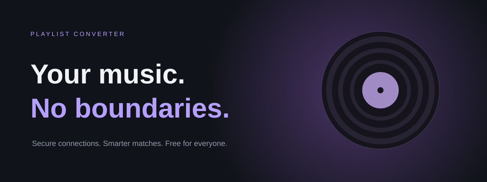
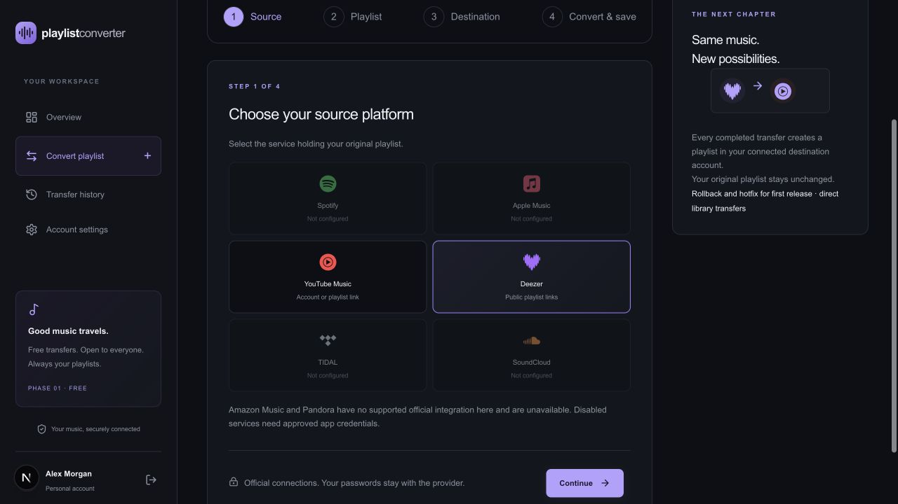
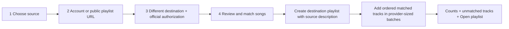

# Playlist Converter

**Rollback and hotfix for first release — direct playlist creation**

Move a playlist into your own destination music account. Official authorization, secure accounts, explicit-song controls, matching confidence, and private transfer history.

[](https://github.com/muffin4lol/playlist-converter/actions/workflows/ci.yml)


[Live deployment](https://playlist-converter-alpha.vercel.app) · [Release and rollback instructions](docs/ROLLBACK.md)

This branch replaces file-based playlist output with direct destination-library creation. A successful new transfer always has a destination playlist. The earlier deployed release remains the rollback checkpoint until this hotfix is released with its database migration. Existing transfer history is preserved and earlier entries that did not create remote playlists are labeled as legacy.



## Four-step wizard

1. **Choose source.** Pick the music service holding your playlist.
2. **Provide playlist.** Load your own playlists after official account authorization, or paste a validated public playlist URL. Public reads do not require a music-account login where the official API supports them and app credentials are configured.
3. **Choose destination and connect.** Source is excluded from destination options. Authorize the destination service; the app shows **Connected as account name**.
4. **Convert and save.** Review tracks, explicit-song settings and confidence scores. Match by ISRC first, then title, artist and duration; create a new destination playlist and add matched tracks. Results show transferred counts, unmatched songs and a link to the playlist.

New playlist description: `Created with Playlist Converter • Imported from Spotify: Original playlist name` (with the actual source/name).

## Features

- 🔐 Free, open registration; verified email required before conversions; login/logout and password recovery.
- 🔗 Official OAuth Code + PKCE where supported; MusicKit authorization for Apple Music. No music-service password forms or scraping.
- 🎵 Account playlist selection and provider-validated public links; normalized title, artist, album, duration and ISRC when provided.
- 🎚️ Explicit songs on by default, clean replacement searches, per-track selection, live counters and unknown-rating disclosure.
- 🔎 ISRC-first matching with fuzzy fallback, confidence scores and preview before conversion.
- ⏳ Server-persisted wizard and transfer state; back navigation and OAuth return preserve selections. Interrupted transfers can resume without silently duplicating uncertain writes.
- 📚 Private, searchable, filtered, paginated history with per-track outcomes, rerun and deletion.
- 👤 Profile editing, password changes, account data access/deletion, and cascading account deletion.
- 🌗 Responsive dark/light UI, keyboard-accessible controls, ARIA step/progress indicators, reduced-motion support.

## Official platform support and limitations

| Platform               | Account authorization                         | Public playlist URL without user login                                      | Destination                                                                                                     |
| ---------------------- | --------------------------------------------- | --------------------------------------------------------------------------- | --------------------------------------------------------------------------------------------------------------- |
| Spotify                | Authorization Code + PKCE                     | Client Credentials with server app secret; provider tier restrictions apply | Creates a playlist; adds up to 100 tracks per adapter request                                                   |
| YouTube Music          | Google OAuth + PKCE                           | YouTube Data API with a server API key                                      | Creates a private YouTube playlist visible in YouTube Music where supported; YouTube accepts one item per write |
| Apple Music            | MusicKit developer token + Music User Token   | Catalog playlists with developer token                                      | Creates a library playlist; active subscription/storefront support required                                     |
| Deezer                 | Approved OAuth application                    | Official public playlist endpoint                                           | Creates playlist; provider-default visibility; batches of 50                                                    |
| TIDAL                  | Authorization Code + PKCE                     | Account connection required in this adapter                                 | Creates an unlisted playlist; batches of 50                                                                     |
| SoundCloud             | OAuth 2.1 + PKCE                              | Account connection required in this adapter                                 | Creates a private playlist; updates track references                                                            |
| Amazon Music / Pandora | No supported official integration in this app | Unavailable                                                                 | Unavailable                                                                                                     |

Disabled connections need provider credentials and approval, not an invitation to this app. YouTube Music has no separate official playlist API: this implementation uses YouTube Data API v3. YouTube explicit ratings are unknown unless age-restricted; they cannot certify that a song is clean. Apple Music's developer JWT is intentionally supplied to MusicKit in authenticated browsers; the signing key and OAuth client secrets stay outside frontend code.

Spotify development/API access restrictions, Google unverified-app warnings and user caps, and other provider approval rules are external requirements. Credentials alone do not prove API access. Only YouTube flows have been live tested; other adapter contracts have automated tests but require approved-account validation.

Public/private URL errors are reported without scraping. Shortened links are not followed; paste the canonical provider playlist URL. Maximum supported playlist size is 1,000 tracks, with a clear error instead of silent truncation.

## Security

- bcrypt cost 12, required names/email/confirmed password, max 72 UTF-8 password bytes; no plaintext passwords in storage.
- Opaque hashed sessions; production `__Host-` Secure, httpOnly, SameSite=Lax cookies; login backoff and persistent rate limits.
- Exact-origin CSRF checks; single-use session-bound OAuth state; nonce CSP, HSTS, frame denial, HTTPS enforcement.
- Server-side AES-256-GCM encryption of provider tokens; tokens bound to user/session/role. OAuth refresh tokens are encrypted and refresh rotation is serialized per connection. Reconnect when MusicKit/Deezer authorization expires or access is revoked.
- Scope-separated source read / destination write where provided. Google, MusicKit and SoundCloud can require broader consent; the UI explains it.
- Prisma parameterized queries, Zod input validation, allowlisted URL parsing and ownership checks on every history/detail/rerun route.
- Backoff for 429 and safe-read failures. Uncertain writes stop for inspection rather than automatic duplication. Do not rerun a failed external write before checking the destination playlist.
- Authenticated daily expiry cleanup at 03:00 UTC on Vercel. Configure database backups and operational retention.

See [SECURITY.md](SECURITY.md). This implementation is not an independent security audit. Self-hosters must update the legal operator/contact information.

## Quick start

Requires Node.js 22+, PostgreSQL and SMTP. Docker Compose supplies local PostgreSQL and Mailpit.

```sh
git clone https://github.com/muffin4lol/playlist-converter.git
cd playlist-converter
cp .env.example .env
npm ci
docker compose up -d
openssl rand -hex 32  # save as TOKEN_ENCRYPTION_KEY in .env
npm run db:deploy
npm run dev
```

Set `APP_URL` to the exact local origin used in the browser. Register, verify through the local email inbox, then configure at least one official source-read path and a different destination provider. No seeded public accounts or authentication bypass exist.

For a disposable local database, `npm run dev:mail` provides a localhost-only SMTP sink on 1025 and inbox on 8025. Never expose it publicly. [Temporary sender and later domain setup](docs/TEMPORARY-EMAIL.md).

## Environment and provider setup

Every key is documented in [.env.example](.env.example). Secrets must not use a `NEXT_PUBLIC_` prefix.

| Setting                                                                 | Purpose                                                                              |
| ----------------------------------------------------------------------- | ------------------------------------------------------------------------------------ |
| `DATABASE_URL`                                                          | PostgreSQL with TLS and production pooling                                           |
| `APP_URL`                                                               | Canonical HTTPS origin                                                               |
| `TOKEN_ENCRYPTION_KEY`                                                  | Separate, stable 32-byte hex production encryption key                               |
| `CRON_SECRET`                                                           | Independent Vercel cleanup authorization                                             |
| `SMTP_URL`, `EMAIL_FROM`                                                | Verification/reset/support mail                                                      |
| `PUBLIC_SUPPORT_EMAIL`                                                  | Approved public support/privacy contact                                              |
| `SPOTIFY_CLIENT_ID`, `SPOTIFY_CLIENT_SECRET`                            | Spotify developer app; secret needed only for anonymous public catalog reads         |
| `GOOGLE_CLIENT_ID`, `GOOGLE_CLIENT_SECRET`                              | Google OAuth web app; enable YouTube Data API v3                                     |
| `YOUTUBE_API_KEY`                                                       | Server-only, API-restricted key for public playlist reads without user authorization |
| `GOOGLE_OAUTH_TESTING`                                                  | Show testing restrictions while Google consent app is unpublished                    |
| `APPLE_MUSIC_DEVELOPER_TOKEN`, `APPLE_MUSIC_STOREFRONT`                 | MusicKit signed developer JWT and storefront                                         |
| `DEEZER_APP_ID`, `DEEZER_APP_SECRET`                                    | Approved Deezer developer app                                                        |
| `TIDAL_CLIENT_ID`, optional `TIDAL_CLIENT_SECRET`, `TIDAL_COUNTRY_CODE` | TIDAL developer app/market                                                           |
| `SOUNDCLOUD_CLIENT_ID`, `SOUNDCLOUD_CLIENT_SECRET`                      | SoundCloud OAuth application                                                         |

Create developer applications at [Spotify](https://developer.spotify.com/dashboard), [Google Cloud](https://console.cloud.google.com/), [Apple MusicKit](https://developer.apple.com/musickit/), [Deezer](https://developers.deezer.com/), [TIDAL](https://developer.tidal.com/) and [SoundCloud](https://developers.soundcloud.com/).

Register `https://YOUR_DOMAIN/api/platforms/PLATFORM/callback` exactly for Spotify, YouTube, Deezer, TIDAL and SoundCloud. Local callback origin must match `APP_URL`. Apple uses MusicKit JS authorization instead of a generic callback. Google source scope is `youtube.readonly`; destination is `youtube.force-ssl`. Spotify uses playlist-read scopes for source and private-playlist modification for destination. Use separate development and production provider applications where required; submit Google sensitive scopes and other provider approval requests before broad launch.

## Architecture

```text
src/app/api/auth/           account verification, recovery, sessions
src/app/api/platforms/      official connect/callback, account/public playlist reads
src/app/api/musickit/       developer JWT and validated user authorization
src/app/api/wizard/         per-user four-step state
src/app/api/matches/        authorized destination match preview
src/app/api/convert/        create a direct-account transfer job
src/app/api/transfers/      private history and resumable write batches
src/lib/platforms/         adapters, URL validation, encrypted refresh lifecycle
src/lib/transfer.ts         ordered matching / batched writes with crash guards
prisma/                    schema and versioned migrations
scripts/                   release build and isolated account smoke tests
```

```mermaid
sequenceDiagram
  participant U as User
  participant A as App
  participant P as Music provider
  U->>A: Connect source/destination
  A->>P: Official authorization + state + PKCE
  P->>U: Login and consent
  P->>A: Authorization code callback
  A->>P: Exchange code / refresh securely
  A->>A: Encrypt tokens; bind to app session
  A->>U: Connected as account name
```



## Checks

```sh
npm run lint
npm run typecheck
npm test
npm run build
```

Tests cover account flows, ownership, strict playlist URLs, provider scopes, public read contracts, encrypted token refresh, matching/explicit controls, direct-only authorization, ordered batches and interrupted writes. CI also applies migrations and runs real HTTP/database account/reset/authorization checks against a disposable database and local SMTP sink. Tests do not substitute for live provider approval/account validation.

## Adding a platform

Implement `PlatformAdapter` in one provider file: official authorization/callback, optional refresh/public read, account playlists, playlist tracks, search, create with description, add tracks and revoke. Normalize metadata to `Track`; preserve unknown explicit ratings. Register the adapter, capability/configuration flags and UI card; document credentials and add contract tests. No core wizard rewrite is needed.

## Roadmap

- [x] Phase 1 free, open registration and verified account security
- [x] Four-step direct-library wizard and public-link input
- [x] Explicit controls, confidence review and per-user history
- [x] Refreshable encrypted OAuth connections and batched writes
- [ ] Approved live access for every provider and completed Google verification
- [ ] Independent accessibility/security review and background queue
- [ ] Later phases: optional premium features, more official integrations, scheduled sync

## Contributing and license

See [CONTRIBUTING.md](CONTRIBUTING.md), [security reporting](SECURITY.md), and the [MIT License](LICENSE). Platform trademarks belong to their owners. Playlist Converter is not affiliated with any music streaming platform. Icons use [Simple Icons](https://simpleicons.org/) under CC0.
